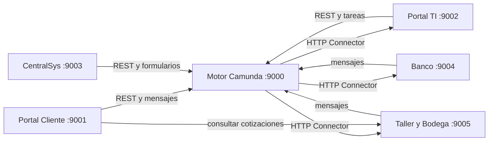

# Corocora Benz

Demostración académica de Postventa, Incidentes de TI y Nómina con Camunda 7 y seis aplicaciones Spring Boot. Los datos, los servicios bancarios y las reglas de nómina son simulados.

## Arquitectura



El motor usa JavaDelegates para nómina y notificaciones, y conectores HTTP para los servicios externos y tickets. Banco y Bodega responden mediante mensajes con la misma `businessKey`. No se necesitan workers JavaScript. Los modelos editables están en `bpmn/`, `dmn/` y `form/`; al cambiar uno se debe actualizar su copia idéntica en `cb-bpm-engine/src/main/resources/static.*`.

## Puesta en marcha

Requisitos: Java 17 o superior, Maven 3.9 y Node.js 18 o superior para las pruebas. Para PostgreSQL, crea las bases con `psql -U postgres -f corocora-benz-embebida/crear-bases.sql`. Configura `DB_HOST`, `DB_PORT`, `DB_USER`, `DB_PASSWORD` según el entorno. El perfil `h2` usa bases en memoria independientes que se borran al detener cada aplicación.

Desde `corocora-benz-embebida` compila con `mvn package`, y ejecuta cada jar en una terminal diferente:

```powershell
java -jar cb-bpm-engine/target/cb-bpm-engine-1.0.0-SNAPSHOT.jar --spring.profiles.active=h2
java -jar cb-portal-cliente/target/cb-portal-cliente-1.0.0-SNAPSHOT.jar --spring.profiles.active=h2
java -jar cb-portal-ti/target/cb-portal-ti-1.0.0-SNAPSHOT.jar --spring.profiles.active=h2
java -jar cb-central-sys/target/cb-central-sys-1.0.0-SNAPSHOT.jar --spring.profiles.active=h2
java -jar cb-banco/target/cb-banco-1.0.0-SNAPSHOT.jar --spring.profiles.active=h2
java -jar cb-taller-bodega/target/cb-taller-bodega-1.0.0-SNAPSHOT.jar --spring.profiles.active=h2
```

Sin el argumento del perfil se usa PostgreSQL. Arranca los seis servicios para recorrer todos los procesos. Por defecto escuchan solo en `127.0.0.1`; `SERVER_ADDRESS` permite cambiar la interfaz de escucha. Las URLs de integración se configuran con `ENGINE_REST_URL`, `PORTAL_TI_URL`, `BANCO_URL` y `TALLER_BODEGA_URL`. Las notificaciones se registran en el log; `CORREO_HABILITADO=true` activa SMTP, configurable mediante `MAIL_HOST` y `MAIL_PORT`.

- Portal del cliente: http://localhost:9001
- Mesa de ayuda TI: http://localhost:9002
- CentralSys: http://localhost:9003
- Swagger y Cockpit: http://localhost:9000/swagger-ui.html y http://localhost:9000/camunda/app/cockpit/ (`demo` / `demo`)

En CentralSys elige el grupo correspondiente, reclama y completa su tarea. Desde el portal TI se reporta y confirma la solución usando el mismo identificador de usuario. El portal de clientes usa el nombre para consultar solicitudes y responder cotizaciones pendientes. Form-js se sirve localmente desde CentralSys; no requiere conexión a Internet para cargar los formularios.

**Entorno de demostración:** la selección de usuario y grupo no implementa autenticación ni aislamiento de datos. No exponer estos servicios ni usar datos reales sin agregar controles de acceso, protección de datos y configuración de producción.

El banco acepta una cuenta con formato `000-123` y rechaza otros formatos; la bodega entrega los repuestos automáticamente después de diez segundos. Los vehículos de muestra incluyen `CB0TEST0000000001` y `WDB0000000000000B`, `WDB0000000000000C`, `WDB0000000000000D`.

## Pruebas

Con motor, Portal TI, Banco y Taller-Bodega arrancados, ejecuta `node corocora-benz-embebida/tests/e2e.mjs`. La prueba recorre 12 escenarios y controla temporalmente las respuestas automáticas de banco y bodega. También valida los formularios desplegados y detecta incidentes en el motor. Las pruebas de permisos, identidades y regresión contienen expectativas de seguridad que aún no están implementadas y actualmente fallan; consulta [funcionamiento y límites](docs/FUNCIONAMIENTO-Y-LIMITES.md).

Integrantes: Sander Farid Sierra Reyes (TI), Miguel Ángel Rincón Morales (Postventa) y Nicolas Alejandro Cabezas Daza (Nómina). Los documentos de referencia están en `docs/`; consulta [funcionamiento y límites](docs/FUNCIONAMIENTO-Y-LIMITES.md) antes de presentar la demostración.
