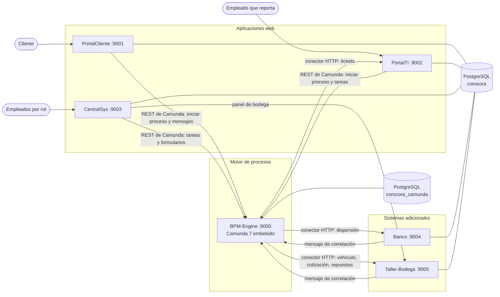

# Corocora Benz

Repositorio hub del proyecto de semestre de Software Basado en Procesos de Negocio. Contiene los modelos de proceso, las seis aplicaciones, las pruebas y la guía general para instalar y demostrar el sistema. Cada aplicación está publicada además en su propio repositorio (ver [Repositorios](#3-repositorios)).

Es una demostración académica: los datos, el banco, la bodega y las reglas de nómina son simulados.

**Contenido**

1. [Contexto y alcance](#1-contexto-y-alcance)
2. [Arquitectura](#2-arquitectura)
3. [Repositorios](#3-repositorios)
4. [Instalación y configuración](#4-instalación-y-configuración)
5. [Uso](#5-uso)
6. [Pruebas y demostración](#6-pruebas-y-demostración)
7. [Documentación](#7-documentación)

## 1. Contexto y alcance

### La organización

Corocora Benz es una empresa ficticia del sector automotor: vende vehículos y los atiende después de la venta en sus talleres. Para operar depende de tres frentes que involucran a personas de áreas distintas y a sistemas externos: el servicio de postventa al cliente, el soporte de tecnología a sus empleados y el pago de la nómina.

### El problema

Estos tres frentes se llevan con pasos manuales y sistemas que no se hablan entre sí. Un cliente no sabe en qué va su vehículo, un incidente de TI se pierde entre la mesa de servicio y el soporte, y la nómina depende de que cada área recuerde su turno y de una respuesta del banco que nadie vigila. No hay un responsable claro de cada paso, ni plazos controlados, ni registro de lo que pasó con cada caso.

### El objetivo

Construir un sistema de información basado en procesos de negocio: los tres procesos se modelan en BPMN, se ejecutan en un motor Camunda 7 embebido en Spring Boot, y ese motor orquesta las aplicaciones que usan los participantes y los sistemas externos. Cada participante trabaja en su propia aplicación; el motor decide qué sigue, a quién le toca, vigila los plazos y deja registro de cada caso.

### Procesos incluidos

| Proceso | Qué resuelve | Subproceso reutilizable | Decisión (DMN) |
|---|---|---|---|
| Postventa y Garantías | Atiende la solicitud de servicio de un cliente: cobertura, cotización, repuestos, taller y entrega | Orden de Taller | Evaluar cobertura de garantía |
| Gestión de Incidentes TI | Atiende el incidente que reporta un empleado: prioridad, asignación, solución y confirmación | Resolución Técnica TI | Clasificar incidente |
| Gestión de Nómina | Liquida y paga un periodo: novedades, validación, aprobación y dispersión bancaria | Validación de Novedad | Clasificar excepción de nómina |

La descripción completa de cada proceso (participantes, tareas, compuertas, eventos y variables) está en [docs/PROCESOS.md](docs/PROCESOS.md).

### Participantes

| Participante | Tipo | Procesos | Aplicación que usa |
|---|---|---|---|
| Cliente | Externo | Postventa | PortalCliente |
| Empleado que reporta un incidente (Usuario Interno Solicitante) | Interno | Incidentes TI | PortalTI |
| Mesa de Servicio, Soporte TI Nivel 1, Soporte Especializado, Responsable del Servicio TI | Interno | Incidentes TI | CentralSys |
| Analista de Nómina, Gestión de Talento Humano, Jefatura de Nómina, Tesorería | Interno | Nómina | CentralSys |
| Asesor de Servicio, Analista de Garantías, Coordinador de Postventa, Técnico de Taller, Inspector de Calidad | Interno | Postventa | CentralSys |
| Encargado de bodega | Interno | Postventa | CentralSys (panel de bodega) |
| Banco | Sistema externo | Nómina | Banco (servicio REST) |
| Bodega de repuestos y taller | Sistema externo | Postventa | Taller-Bodega (servicio REST) |

### Alcance

Incluye:

- Los tres procesos principales, sus tres subprocesos reutilizables y tres tablas de decisión, desplegados y ejecutables en Camunda 7.
- Una aplicación web para el participante externo (PortalCliente), una para el empleado que reporta incidentes (PortalTI) y una para los empleados que atienden tareas por rol (CentralSys).
- Dos sistemas adicionales que el motor invoca por HTTP y que le responden por mensajes: Banco y Taller-Bodega.
- Persistencia en PostgreSQL: una base para el motor y una base de negocio.
- Inicio de sesión por aplicación, permisos por grupo y una credencial interna entre sistemas.
- Pruebas automatizadas de los caminos principales, alternos y de excepción.

No incluye (ver [funcionamiento y límites](docs/FUNCIONAMIENTO-Y-LIMITES.md)): pagos ni liquidaciones reales, integración con un banco o un inventario verdaderos, seguridad de nivel de producción (no hay HTTPS y las credenciales de demostración son públicas) ni despliegue en contenedores.

### Integrantes y responsabilidades

| Integrante | Proceso a cargo | Archivos de los que responde |
|---|---|---|
| Sander Farid Sierra Reyes | Gestión de Incidentes TI | `bpmn/principales/CB_GestionIncidenteTI.bpmn`, `bpmn/reutilizables/CB_ResolverIncidenteTI.bpmn`, `dmn/CB_ClasificarIncidenteTI.dmn`, `form/ti-*.form` |
| Miguel Ángel Rincón Morales | Postventa y Garantías | `bpmn/principales/CB_PostventaGarantias.bpmn`, `bpmn/reutilizables/CB_AtenderOrdenTaller.bpmn`, `dmn/CB_EvaluarCoberturaGarantia.dmn`, `form/postventa-*.form`, `form/taller-diagnostico.form` |
| Nicolas Alejandro Cabezas Daza | Gestión de Nómina | `bpmn/principales/CB_GestionNomina.bpmn`, `bpmn/reutilizables/CB_ValidarNovedadEmpleado.bpmn`, `dmn/CB_ClasificarExcepcionNomina.dmn`, `form/nomina-*.form` |

Las seis aplicaciones, la librería común, las pruebas de integración y la documentación son trabajo conjunto de los tres integrantes.

## 2. Arquitectura



### Componentes

| Componente | Puerto | Qué es | Qué parte del proceso atiende |
|---|---|---|---|
| BPM-Engine (`cb-bpm-engine`) | 9000 | Motor Camunda 7 embebido en Spring Boot. Despliega los BPMN, DMN y formularios al arrancar; ejecuta las tareas automáticas con JavaDelegates y conectores HTTP; crea las cuentas de demostración | Todos los procesos: es el orquestador |
| PortalCliente (`cb-portal-cliente`) | 9001 | Web del participante externo | Pool Cliente de Postventa: registra la solicitud (inicia la instancia), sigue su caso y responde la cotización |
| PortalTI (`cb-portal-ti`) | 9002 | Web del empleado que reporta, y API de tickets | Carril Usuario Interno Solicitante de Incidentes TI: reporta (inicia la instancia) y confirma o rechaza la solución. El motor registra y actualiza los tickets aquí por conector |
| CentralSys (`cb-central-sys`) | 9003 | Web de los empleados | Todos los carriles internos de los tres procesos: bandeja de tareas por grupo, formularios de Camunda, inicio de la nómina y panel de bodega |
| Banco (`cb-banco`) | 9004 | Servicio REST, sin pantallas | Pool Banco de Nómina: recibe el lote de dispersión y responde aceptado o rechazado |
| Taller-Bodega (`cb-taller-bodega`) | 9005 | Servicio REST, sin pantallas | Pool Bodega de repuestos de Postventa: consulta del vehículo, cotización, reserva y entrega de repuestos |
| Común (`cb-comun`) | — | Librería compartida, no se ejecuta | Credencial interna, cliente REST del motor, inicio de sesión de los portales y recursos web comunes |

### Conexiones

- **Personas → aplicaciones web.** El navegador solo habla con el backend de su propio portal (`/api/app/**`), con sesión y protección CSRF. Nunca llama al motor, al Banco ni a la Bodega.
- **Aplicaciones web → motor.** El backend de cada portal usa la API REST de Camunda (`/engine-rest`) para iniciar instancias, correlacionar mensajes, consultar tareas y completarlas con sus variables.
- **Motor → sistemas.** Las tareas de servicio usan el conector HTTP de Camunda para llamar a PortalTI (tickets), Banco (dispersión) y Taller-Bodega (vehículo, cotización, repuestos). El resultado de cada llamada se guarda en variables del proceso y decide el camino. La lógica interna (cálculo de nómina, notificaciones) usa JavaDelegates.
- **Sistemas → motor.** Banco y Taller-Bodega responden de forma asíncrona con un mensaje de correlación que lleva la misma `businessKey` de la instancia.
- **Credencial interna.** Toda llamada entre sistemas lleva el encabezado `X-CB-Internal`; sin él, el motor y las APIs internas responden 401.
- **Bases de datos.** El motor guarda definiciones, instancias, tareas, variables e historial en `corocora_camunda`. Las cinco aplicaciones guardan sus datos de negocio en `corocora`, cada una en sus propias tablas (`pc_`, `ti_`, `cs_`, `banco_`, `tb_`). Cada registro de negocio guarda la `businessKey` de su instancia. El detalle está en [docs/MODELO-DE-DATOS.md](docs/MODELO-DE-DATOS.md).

El detalle de cada API está en el [contrato de integración](docs/CONTRATO-INTEGRACION.md), y la correspondencia tarea por tarea entre aplicaciones y procesos, en [docs/PROCESOS.md](docs/PROCESOS.md).

## 3. Repositorios

Este repositorio es el hub: tiene el código completo y es el que se clona para instalar el sistema. Cada componente está publicado también en su propio repositorio, con su README (propósito, API, configuración e instrucciones).

| Componente | Repositorio | Carpeta en el hub |
|---|---|---|
| Hub integrador | https://github.com/MiguelMorales1125/Corocora-Benz | — |
| BPM-Engine | https://github.com/MiguelMorales1125/CorocoraBenz-BPM-Engine | [`corocora-benz-embebida/cb-bpm-engine`](corocora-benz-embebida/cb-bpm-engine) |
| PortalCliente | https://github.com/MiguelMorales1125/CorocoraBenz-PortalCliente | [`corocora-benz-embebida/cb-portal-cliente`](corocora-benz-embebida/cb-portal-cliente) |
| PortalTI | https://github.com/MiguelMorales1125/CorocoraBenz-PortalTI | [`corocora-benz-embebida/cb-portal-ti`](corocora-benz-embebida/cb-portal-ti) |
| CentralSys | https://github.com/MiguelMorales1125/CorocoraBenz-CentralSys | [`corocora-benz-embebida/cb-central-sys`](corocora-benz-embebida/cb-central-sys) |
| Banco | https://github.com/MiguelMorales1125/CorocoraBenz-Banco | [`corocora-benz-embebida/cb-banco`](corocora-benz-embebida/cb-banco) |
| Taller-Bodega | https://github.com/MiguelMorales1125/CorocoraBenz-TallerBodega | [`corocora-benz-embebida/cb-taller-bodega`](corocora-benz-embebida/cb-taller-bodega) |
| Común (librería) | https://github.com/MiguelMorales1125/CorocoraBenz-Comun | [`corocora-benz-embebida/cb-comun`](corocora-benz-embebida/cb-comun) |

Qué hay en el hub:

| Carpeta | Contenido |
|---|---|
| `bpmn/`, `dmn/`, `form/` | Modelos editables (Camunda Modeler). El motor despliega una copia idéntica desde `cb-bpm-engine/src/main/resources/static.*`; al cambiar un modelo hay que actualizar las dos |
| `corocora-benz-embebida/` | Proyecto Maven con los siete módulos, el pom padre, los scripts de arranque, la configuración de ejemplo y los scripts de base de datos |
| `corocora-benz-embebida/tests/` | Pruebas de integración contra los sistemas arrancados |
| `docs/` | Documentación del proyecto |

Los componentes heredan el pom padre del hub y usan la librería común, así que se compilan desde el hub. Los repositorios de componente se publican desde su carpeta con [`publicar-componentes.sh`](corocora-benz-embebida/publicar-componentes.sh) (`git subtree`), de modo que conservan su historial y quedan iguales a la carpeta del hub.

## 4. Instalación y configuración

### Requisitos

| Herramienta | Versión | Notas |
|---|---|---|
| Java (JDK) | 17 o superior | Probado con 24 |
| Maven | No hace falta instalarlo | El proyecto trae su wrapper (Maven 3.9.9) |
| PostgreSQL | 17 | Opcional: con el perfil `h2` no se necesita |
| Node.js | 20 o superior | Solo para las pruebas de integración. Probado con 24 |
| Git | Cualquiera reciente | |

Versiones del proyecto: Camunda Platform 7.24.0, Spring Boot 3.5.6, compilado para Java 17.

### Puertos y orden de arranque

| Orden | Sistema | Puerto |
|---|---|---|
| 1 | BPM-Engine | 9000 |
| 2 | PortalCliente | 9001 |
| 2 | PortalTI | 9002 |
| 2 | CentralSys | 9003 |
| 2 | Banco | 9004 |
| 2 | Taller-Bodega | 9005 |

El motor arranca primero y los demás cuando ya responde, porque validan contra él los usuarios. Los scripts de arranque lo hacen solos. PostgreSQL usa el 5432.

### Pasos

**1. Clonar y compilar** (la primera vez descarga las dependencias y tarda unos minutos):

```powershell
git clone https://github.com/MiguelMorales1125/Corocora-Benz.git
cd Corocora-Benz\corocora-benz-embebida
.\mvnw.cmd package -DskipTests
```

En Linux o macOS: `./mvnw package -DskipTests`.

**2. Elegir la base de datos.**

- *Rápido, sin instalar nada:* perfil `h2`. Cada sistema usa una base en memoria que se borra al detenerlo. Salta al paso 4 y arranca con `h2`.
- *PostgreSQL:* crea las dos bases una sola vez (pide la contraseña del usuario `postgres`):

  ```powershell
  psql -U postgres -p 5432 -f crear-bases.sql
  ```

  Las tablas no hay que crearlas: Camunda crea las suyas y cada sistema crea las de negocio al arrancar. El esquema resultante está en [`esquema-negocio.sql`](corocora-benz-embebida/esquema-negocio.sql) como referencia.

**3. Configurar** (solo si tu PostgreSQL no usa `postgres` / `postgres` en `localhost:5432`, o si quieres cambiar algo). Copia el archivo de ejemplo y edítalo:

```powershell
copy configuracion.ejemplo.env configuracion.env
```

Los scripts de arranque leen `configuracion.env` y pasan sus variables a los seis sistemas. Ese archivo no se sube a git. También sirven las variables de entorno del sistema operativo.

**4. Arrancar.**

```powershell
.\iniciar-sistemas.bat        # PostgreSQL
.\iniciar-sistemas.bat h2     # bases en memoria
```

En Windows se abre una ventana por sistema; para detenerlos, cierra las ventanas. En Linux, macOS o Git Bash: `./iniciar-sistemas.sh` (o `./iniciar-sistemas.sh h2`), que los deja en segundo plano con su salida en `logs/`, y `./detener-sistemas.sh` para detenerlos.

También se puede arrancar cada sistema a mano, empezando por el motor: `java -jar cb-bpm-engine/target/cb-bpm-engine-1.0.0-SNAPSHOT.jar` (añade `--spring.profiles.active=h2` para H2), y lo mismo con `cb-portal-cliente`, `cb-portal-ti`, `cb-central-sys`, `cb-banco` y `cb-taller-bodega`.

**5. Comprobar.** Abre http://localhost:9003 y entra con `demo` / `demo`. Para una comprobación completa, ejecuta las pruebas de integración (sección 6).

Si ya tenías las bases de PostgreSQL de una versión anterior del proyecto, recréalas antes de arrancar (`DROP DATABASE corocora_camunda; DROP DATABASE corocora;` y de nuevo `crear-bases.sql`): las instancias que quedaron en curso siguen en la versión vieja de los modelos y terminarían en incidente.

### Variables de configuración

Todas son opcionales; [`configuracion.ejemplo.env`](corocora-benz-embebida/configuracion.ejemplo.env) las trae con su valor por defecto.

| Variable | Para qué | Valor por defecto |
|---|---|---|
| `DB_HOST`, `DB_PORT`, `DB_USER`, `DB_PASSWORD` | Conexión a PostgreSQL | `localhost`, `5432`, `postgres`, `postgres` |
| `DB_ENGINE_NAME`, `DB_NAME` | Base del motor y base de negocio | `corocora_camunda`, `corocora` |
| `COROCORA_INTERNAL_TOKEN` | Credencial interna entre sistemas. Debe ser la misma en los seis | `cb-local-interno-demo` |
| `SERVER_ADDRESS` | Interfaz en la que escucha cada sistema | `127.0.0.1` |
| `ENGINE_REST_URL`, `PORTAL_TI_URL`, `BANCO_URL`, `TALLER_BODEGA_URL` | Dónde encuentra cada sistema a los demás | `http://localhost:900x` |
| `COROCORA_DEMO_IDENTIDADES` | `false` para que el motor no cree las cuentas de demostración | `true` |
| `COROCORA_DEMO_PASSWORD` | Contraseña de las cuentas de demostración que se creen (no cambia las que ya existen) | `demo` |
| `CORREO_HABILITADO`, `MAIL_HOST`, `MAIL_PORT` | Envío de notificaciones por SMTP; si no, quedan en el log del motor | `false`, `localhost`, `1025` |
| `BANCO_RESPUESTA_AUTOMATICA` | `false` para que el Banco no responda solo las dispersiones y espere la respuesta manual por su API | `true` |
| `BODEGA_RESPUESTA_AUTOMATICA` | `false` para que la Bodega no entregue sola los repuestos y espere la entrega manual por su API o por el panel de bodega de CentralSys | `true` |

Las dos últimas fijan el valor con el que arranca cada simulador; también se cambian sin reiniciar con `PUT /api/simulacion` (sección 7 del [contrato de integración](docs/CONTRATO-INTEGRACION.md)).

## 5. Uso

- Portal del cliente: http://localhost:9001
- Mesa de ayuda TI: http://localhost:9002
- CentralSys: http://localhost:9003
- Cockpit y Tasklist de Camunda: http://localhost:9000/camunda/app/cockpit/ y http://localhost:9000/camunda/app/tasklist/ (`demo` / `demo`). En "Start process" de Tasklist solo aparecen los tres procesos principales, cada uno con su formulario de inicio.
- Swagger del motor: http://localhost:9000/swagger-ui.html. El botón "Authorize" fija la credencial interna.

Para probar rápido, los formularios de los portales y todos los formularios de Camunda vienen rellenos con valores de demostración (las excepciones son el nuevo responsable de la revisión de SLA y los campos de solo lectura que muestran el motivo de una devolución, vacíos hasta que la haya).

### Cuentas de demostración

Las crea el motor al arrancar. Todas usan la contraseña `demo`, salvo `USR-01`, cuya contraseña es `USR-01`.

| Cuenta | Grupo | Dónde entra |
|---|---|---|
| `cliente1`, `cliente2` | `clientes` | Portal del cliente |
| `USR-01` | (empleado sin grupo) | Portal TI: reporta incidentes y confirma la solución |
| `mesa1` | `mesa-servicio` | CentralSys |
| `soporte1`, `especialista1` | `soporte-ti-n1`, `soporte-ti-especializado` | CentralSys |
| `responsable1` | `responsables-ti` | CentralSys |
| `nomina1`, `talento1`, `jefatura1`, `tesoreria1` | `analistas-nomina`, `gestion-talento-humano`, `jefatura-nomina`, `tesoreria` | CentralSys |
| `asesor1`, `garantia1`, `coordinador1` | `asesores-servicio`, `analistas-garantia`, `coordinadores-postventa` | CentralSys |
| `tecnico1`, `calidad1` | `tecnicos-taller`, `inspectores-calidad` | CentralSys |
| `bodega1` | `bodega` | CentralSys (panel de bodega) |
| `demo` | `camunda-admin` | Administrador: CentralSys, Portal TI y las webapps de Camunda |

### Qué hace cada aplicación

- **Portal del cliente:** el cliente registra una solicitud de servicio, ve solo las suyas y responde la cotización cuando el proceso la espera.
- **Portal TI:** cualquier empleado reporta un incidente, sigue sus tickets y confirma o rechaza la solución.
- **CentralSys:** cada empleado ve las tareas libres de sus grupos y las que tiene asignadas; las reclama, las completa con su formulario y puede soltarlas. `nomina1` inicia la nómina de un periodo y `bodega1` usa el panel de bodega (reservas, solicitudes de repuesto y simulación). Al iniciar la nómina, las casillas «Simular una excepción (demostración)» la envían por una ruta de excepción: periodo cerrado o soportes incompletos dejan una tarea a `talento1`, y novedades fuera de corte, a `jefatura1`.

El banco acepta una cuenta con formato `000-123` y rechaza otros formatos; la bodega entrega los repuestos automáticamente después de diez segundos. Los vehículos de muestra son `CB0TEST0000000001` (con campaña activa) y `WDB0000000000000B`, `WDB0000000000000C`, `WDB0000000000000D` (sin campaña: la garantía los cubre hasta 60 000 km; con más kilometraje reciben cotización).

**Entorno de demostración:** el inicio de sesión, los permisos por grupo y la credencial interna existen para que la demostración sea coherente, no para producción. Las contraseñas y la credencial por defecto son públicas, no hay HTTPS y los datos son de ejemplo. No exponer estos servicios ni usar datos reales; consulta [funcionamiento y límites](docs/FUNCIONAMIENTO-Y-LIMITES.md).

## 6. Pruebas y demostración

Pruebas unitarias y de integración de cada módulo (236 pruebas; no necesitan nada arrancado), desde `corocora-benz-embebida`:

```powershell
.\mvnw.cmd test
```

Pruebas contra los sistemas arrancados, desde `corocora-benz-embebida/tests` (no necesitan `npm install`):

| Comando | Qué comprueba | Sistemas necesarios |
|---|---|---|
| `npm run e2e` | 12 escenarios de los 3 procesos por la REST de Camunda, más la `businessKey` automática | Motor, Portal TI, Banco, Taller-Bodega |
| `npm run identidades` | Cuentas, grupos y motor protegido | Motor |
| `npm run regresion` | Validaciones, reintentos idempotentes y APIs protegidas | Portal TI, Banco, Taller-Bodega |
| `npm run permisos` | Sesión, permisos por grupo, aislamiento entre clientes | Los 6 |
| `npm run portales` | Los 3 procesos de punta a punta por las APIs de los portales | Los 6 |
| `npm run todo` | Todas las anteriores, en ese orden; se detiene en la primera que falle | Los 6 |

Las pruebas usan la credencial interna y la contraseña de demostración por defecto; si las cambiaste, define las mismas variables de entorno al ejecutarlas. `e2e` y `portales` controlan temporalmente las respuestas automáticas de banco y bodega y las restauran al terminar.

Los casos de prueba, con su resultado esperado y obtenido, están en [docs/CASOS-DE-PRUEBA.md](docs/CASOS-DE-PRUEBA.md). El paso a paso para demostrar los tres procesos desde las pantallas está en [docs/GUION-DEMOSTRACION.md](docs/GUION-DEMOSTRACION.md).

## 7. Documentación

| Documento | Contenido |
|---|---|
| [docs/PROCESOS.md](docs/PROCESOS.md) | Descripción de los procesos: participantes, tareas, compuertas, eventos, variables, decisiones y correspondencia con las aplicaciones |
| [docs/CONTRATO-INTEGRACION.md](docs/CONTRATO-INTEGRACION.md) | APIs de cada sistema, sesión, credencial interna y formularios |
| [docs/MODELO-DE-DATOS.md](docs/MODELO-DE-DATOS.md) | Modelo de datos, vínculo con las instancias e inicialización |
| [docs/CASOS-DE-PRUEBA.md](docs/CASOS-DE-PRUEBA.md) | Casos de prueba con resultados esperados y obtenidos |
| [docs/GUION-DEMOSTRACION.md](docs/GUION-DEMOSTRACION.md) | Guion de la demostración de principio a fin |
| [docs/FUNCIONAMIENTO-Y-LIMITES.md](docs/FUNCIONAMIENTO-Y-LIMITES.md) | Qué es simulado, límites de la demostración y cómo vencer un temporizador sin esperar |
| [docs/diagramas_bpmn_corocora_benz.pdf](docs/diagramas_bpmn_corocora_benz.pdf), [docs/formularios_camunda_corocora_benz.pdf](docs/formularios_camunda_corocora_benz.pdf) | Diagramas y formularios en PDF, para leerlos sin Camunda Modeler |
