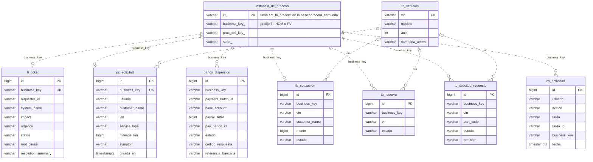

# Modelo de datos y persistencia

Este documento describe dónde y cómo guarda sus datos Corocora Benz: qué bases de datos existen, qué tablas tiene cada sistema, cómo se relaciona cada registro de negocio con su instancia de proceso en Camunda, cómo se crea todo desde cero de forma reproducible y cómo se consultan los datos. Sirve como evidencia del criterio «Persistencia y gestión de datos».

Todo lo que aparece aquí se tomó del código y del esquema real: el archivo [`corocora-benz-embebida/esquema-negocio.sql`](../corocora-benz-embebida/esquema-negocio.sql) (volcado con `pg_dump` de la base en ejecución), las clases `@Entity` de cada módulo, los `application.yaml` y los modelos BPMN de `bpmn/`.

## 1. Vista general

El proyecto son seis aplicaciones Spring Boot: un motor de procesos (Camunda 7.24 embebido) y cinco sistemas de información que el motor orquesta. Los datos se guardan en un servidor PostgreSQL 17 local con **dos bases de datos**, que crea el script [`crear-bases.sql`](../corocora-benz-embebida/crear-bases.sql):

| Base | Quién la usa | Qué contiene | Quién crea las tablas |
|---|---|---|---|
| `corocora_camunda` | Solo el motor (`cb-bpm-engine`, puerto 9000) | Las tablas propias de Camunda (`ACT_*`): modelos desplegados, instancias, tareas, variables, historial y usuarios | Camunda, al arrancar (`camunda.bpm.database.schema-update: true`) |
| `corocora` | Portal Cliente (9001), Portal TI (9002), CentralSys (9003), Banco (9004) y Taller-Bodega (9005) | Las 8 tablas de negocio | Cada sistema crea las suyas al arrancar, con JPA (`spring.jpa.hibernate.ddl-auto: update`) |

**Por qué el motor tiene su propia base.** Camunda administra su esquema por su cuenta: crea y actualiza él mismo sus 49 tablas `ACT_*`, y de ellas depende el estado de todos los procesos. Tenerlas en una base aparte evita que los sistemas de negocio las lean o las modifiquen directamente: los cinco sistemas hablan con el motor únicamente por su API REST (`/engine-rest`), nunca por SQL. Además permite recrear una base sin tocar la otra.

**Cada sistema es dueño de sus tablas.** Los cinco sistemas de negocio comparten la base `corocora`, igual que en la arquitectura de referencia MSGF, donde los sistemas de información comparten un PostgreSQL local. Aun así no comparten tablas: cada tabla pertenece a un solo sistema, que es el único que la lee y la escribe, y el prefijo del nombre indica el dueño.

| Prefijo | Sistema dueño | Tablas |
|---|---|---|
| `pc_` | Portal Cliente (`cb-portal-cliente`) | `pc_solicitud` |
| `ti_` | Portal TI (`cb-portal-ti`) | `ti_ticket` |
| `cs_` | CentralSys (`cb-central-sys`) | `cs_actividad` |
| `banco_` | Banco (`cb-banco`) | `banco_dispersion` |
| `tb_` | Taller-Bodega (`cb-taller-bodega`) | `tb_vehiculo`, `tb_cotizacion`, `tb_reserva`, `tb_solicitud_repuesto` |

Cuando un sistema necesita un dato de otro lo pide por HTTP (por ejemplo, el panel de bodega de CentralSys consulta las reservas a Taller-Bodega por su API); ningún sistema consulta las tablas de otro.

Los seis `application.yaml` leen la conexión de las mismas variables de entorno: `DB_HOST` (por defecto `localhost`), `DB_PORT` (`5432`), `DB_USER`, `DB_PASSWORD`, `DB_NAME` (`corocora`) y, en el motor, `DB_ENGINE_NAME` (`corocora_camunda`). El archivo `corocora-benz-embebida/configuracion.ejemplo.env` trae los valores de ejemplo.

## 2. Diagrama entidad-relación

El diagrama muestra las 8 tablas de negocio de la base `corocora` con sus columnas principales. La novena caja, `instancia_de_proceso`, **no es una tabla de esta base**: representa la instancia del proceso en Camunda (tabla `act_hi_procinst` de la base `corocora_camunda`) y se dibuja para mostrar con qué se enlaza cada registro.



**Las líneas punteadas son vínculos lógicos, no llaves foráneas.** En el esquema real no existe ninguna restricción `FOREIGN KEY`: las únicas restricciones son las llaves primarias, la unicidad de `business_key` en `ti_ticket` y en `pc_solicitud`, y las restricciones `CHECK` de estado en `banco_dispersion` y `tb_solicitud_repuesto`. Es intencional: cada sistema solo accede a sus tablas, así que el vínculo entre sistemas se hace con dos datos que viajan en las peticiones, en los mensajes y en las variables del proceso:

- **`business_key`**: la clave de negocio de la instancia de proceso. Es el mismo texto en Camunda y en todas las tablas que participan en ese caso.
- **`vin`**: el número de identificación del vehículo. Une la solicitud del cliente con el vehículo registrado y con sus cotizaciones, reservas y solicitudes de repuesto. Un VIN bien formado que no esté en `tb_vehiculo` es válido (se trata como vehículo no registrado y sin garantía), por eso la relación es opcional en el lado del vehículo.

## 3. Tablas de negocio

En todas las tablas con columna `id`, esta es la llave primaria, de tipo `bigint`, generada por la base (`GENERATED BY DEFAULT AS IDENTITY`). En las tablas siguientes, «Obligatoria» significa que la columna es `NOT NULL` en el esquema.

### 3.1 `ti_ticket` (Portal TI)

Guarda un ticket por cada incidente de TI reportado. Hay como máximo un ticket por `business_key`.

| Columna | Tipo | Obligatoria | Significado |
|---|---|---|---|
| `id` | `bigint` | Sí | Llave primaria. El identificador que ven las personas es `TI-<id>` (por ejemplo `TI-15`). |
| `business_key` | `varchar(255)` | Sí, única | Clave de negocio de la instancia de `CB_GestionIncidenteTI`. |
| `requester_id` | `varchar(255)` | No | Usuario de Camunda que reportó el incidente. |
| `system_name` | `varchar(255)` | No | Sistema afectado. |
| `description` | `varchar(4000)` | No | Descripción del incidente. |
| `impact` | `varchar(255)` | No | Impacto declarado (en el portal: `Bajo`, `Medio` o `Alto`). |
| `urgency` | `varchar(255)` | No | Urgencia declarada (en el portal: `Baja`, `Media` o `Alta`). |
| `safety_impact` | `boolean` | No | Indica si afecta la seguridad. |
| `affected_teams` | `integer` | No | Número de equipos afectados. |
| `status` | `varchar(255)` | No | Estado del ticket (ver abajo). |
| `root_cause` | `varchar(4000)` | No | Causa raíz registrada por soporte. |
| `resolution_summary` | `varchar(4000)` | No | Resumen de la solución. |

Aunque el esquema solo exige `id` y `business_key`, la API que crea el ticket valida que lleguen todos los datos del reporte.

Estados (`status`; texto sin restricción `CHECK`) y qué los cambia:

| Estado | Cuándo se pone | Tarea del proceso |
|---|---|---|
| `OPEN` | Al crear el ticket. | «Registrar ticket del incidente» (`createTicket`, `POST /api/tickets`). |
| `RESOLVED` | Cuando soporte registra la solución; en ese momento se guardan `root_cause` y `resolution_summary`. | «Registrar solución en la base de conocimiento» (`recordResolution`, subproceso `CB_ResolverIncidenteTI`, `POST /api/tickets/{ticketId}/solucion`). |
| `CLOSED` | Cuando la persona confirma la solución o pasan 24 horas sin respuesta. | «Cerrar ticket verificado» (`closeTicket`) o «Cerrar ticket por falta de respuesta» (`closeAutoTicket`), ambas con `POST /api/tickets/{ticketId}/cerrar`. |
| `OPEN` (de nuevo) | Cuando la persona responde que la solución no sirvió, el proceso vuelve a soporte. El Portal TI lo detecta al listar los tickets: si el ticket figura `RESOLVED` pero hay otra vez una tarea de soporte para esa `business_key`, lo devuelve a `OPEN`. | Ninguna: lo hace el propio portal (clase `EstadoTicketService`). |

La creación es idempotente: si el motor reintenta la llamada con los mismos datos recibe el ticket que ya existe; con datos distintos para la misma `business_key` recibe un error 409.

### 3.2 `pc_solicitud` (Portal Cliente)

Guarda cada solicitud de servicio creada por un cliente en el portal. Su función principal es recordar **quién es el dueño** de cada `business_key`, para mostrarle a cada cliente solo sus casos. La tabla no tiene columna de estado: el avance de la solicitud se lee del historial del motor cada vez que el cliente consulta.

| Columna | Tipo | Obligatoria | Significado |
|---|---|---|---|
| `id` | `bigint` | Sí | Llave primaria. |
| `business_key` | `varchar(40)` | Sí, única | Clave de negocio `PV-XXXXXXXX` de la instancia de `CB_PostventaGarantias`. |
| `usuario` | `varchar(255)` | Sí | Usuario de Camunda dueño de la solicitud (tiene el índice `ix_pc_solicitud_usuario`). |
| `customer_name` | `varchar(255)` | Sí | Nombre del cliente. |
| `customer_email` | `varchar(255)` | No | Correo para notificaciones; es opcional. |
| `vin` | `varchar(17)` | Sí | VIN del vehículo. |
| `service_type` | `varchar(40)` | Sí | `Garantía`, `Mantenimiento` o `Reparación`. |
| `mileage_km` | `bigint` | Sí | Kilometraje del vehículo. |
| `symptom` | `varchar(255)` | Sí | Síntoma o necesidad descrita por el cliente. |
| `creada_en` | `timestamp with time zone` | Sí | Fecha y hora de creación. |

El registro se crea cuando el cliente envía el formulario del portal (`POST /api/app/client/requests`). La operación es transaccional: primero se guarda la fila (así la `business_key` queda reservada con su dueño) y enseguida se envía al motor el mensaje `SolicitudServicio`, que arranca el proceso. Si el motor no arranca el proceso, la transacción se deshace y la fila no queda guardada: no puede existir una solicitud sin proceso. Después de creada, la fila no se modifica.

Un proceso de postventa iniciado desde Tasklist de Camunda (sin pasar por el portal) no tiene fila en esta tabla; por eso la relación del diagrama es opcional.

### 3.3 `banco_dispersion` (Banco)

Guarda cada lote de dispersión de nómina que el proceso envía al banco simulado, y la respuesta que el banco le dio.

| Columna | Tipo | Obligatoria | Significado |
|---|---|---|---|
| `id` | `bigint` | Sí | Llave primaria. El proceso la guarda en la variable `bankDispersionId`. |
| `business_key` | `varchar(255)` | Sí | Clave de negocio de la instancia de `CB_GestionNomina`; el banco la usa para responderle al motor. |
| `payment_batch_id` | `varchar(255)` | No | Identificador del lote de pago. |
| `bank_account` | `varchar(255)` | No | Cuenta de origen de la dispersión. |
| `payroll_total` | `bigint` | No | Valor total de la nómina. |
| `pay_period_id` | `varchar(255)` | No | Periodo de pago. |
| `estado` | `varchar(255)` | Sí | Estado de la dispersión (ver abajo). Tiene una restricción `CHECK` con los cinco valores. |
| `codigo_respuesta` | `varchar(255)` | No | Código con el que respondió el banco (`00-APROBADA`, `R03-CUENTA-INVALIDA` u otro indicado en una respuesta manual). |
| `referencia_bancaria` | `varchar(255)` | No | Referencia de la aceptación (`BANCO-<id>` si no se indica otra). |
| `intentos_respuesta` | `integer` | Sí | Veces que el banco intentó responder sin que el motor entregara el mensaje. |
| `recibida_en` | `timestamp with time zone` | No | Momento en que llegó la dispersión. |
| `respondida_en` | `timestamp with time zone` | No | Momento en que el motor entregó la respuesta al proceso. |

El registro se crea cuando el proceso ejecuta la tarea «Enviar dispersión al Banco» (`sendBankBatch`, `POST /api/dispersiones`). Es idempotente: si el motor reenvía el mismo lote mientras la dispersión sigue pendiente o aceptada, se devuelve la que ya existe.

Estados (`estado`) y qué los cambia:

| Estado | Significado | Qué lo produce |
|---|---|---|
| `RECIBIDA` | Llegó del motor y falta responder. | Estado inicial. |
| `ACEPTADA` | El banco la aceptó y el motor entregó al proceso el mensaje `DispersionAceptada`. | La respuesta automática (cuenta con formato válido, por ejemplo `000-123`) o `POST /api/dispersiones/{id}/aceptar`. |
| `RECHAZADA` | El banco la rechazó y el motor entregó el mensaje `DispersionRechazada`. | La respuesta automática (cuenta con formato inválido) o `POST /api/dispersiones/{id}/rechazar`. |
| `REEMPLAZADA` | El mismo proceso envió un lote distinto antes de que esta se respondiera. | La llegada del nuevo lote. |
| `SIN_PROCESO` | Al responder ya no había una instancia activa con esa `business_key`; no se reintenta más. | El intento de respuesta (sección 4.3). |

El estado solo pasa a `ACEPTADA` o `RECHAZADA` cuando el motor confirma que entregó el mensaje al proceso.

### 3.4 `cs_actividad` (CentralSys)

Es la bitácora de lo que hace cada empleado en la intranet. Solo se insertan filas; nunca se modifican.

| Columna | Tipo | Obligatoria | Significado |
|---|---|---|---|
| `id` | `bigint` | Sí | Llave primaria. |
| `usuario` | `varchar(255)` | Sí | Usuario de Camunda que hizo la acción. |
| `accion` | `varchar(40)` | Sí | Tipo de acción (ver abajo). |
| `tarea` | `varchar(255)` | No | Nombre de la tarea, cuando la acción es sobre una tarea. |
| `tarea_id` | `varchar(64)` | No | Identificador de la tarea en Camunda. |
| `business_key` | `varchar(255)` | No | Clave de negocio del caso al que pertenece la acción. |
| `detalle` | `varchar(255)` | No | Dato adicional legible (el periodo de nómina, la reserva avisada, el nuevo responsable). |
| `fecha` | `timestamp with time zone` | Sí | Momento de la acción. |

La tabla tiene el índice `cs_actividad_usuario` sobre (`usuario`, `fecha`), porque la consulta de la aplicación es «las últimas 20 acciones de este usuario».

Valores de `accion` (los define la enumeración `Accion` del código; la columna es texto sin restricción `CHECK`):

| Valor | Qué operación lo registra |
|---|---|
| `RECLAMAR` | Un empleado toma una tarea de la bandeja. |
| `SOLTAR` | Un empleado devuelve una tarea a la bandeja. |
| `COMPLETAR` | Un empleado completa una tarea con su formulario. |
| `INICIAR_NOMINA` | Un analista de nómina inicia el proceso `CB_GestionNomina`. |
| `AVISAR_DISPONIBILIDAD` | Bodega avisa que llegaron los repuestos de una reserva pendiente. |
| `ENTREGAR_REPUESTO` | Bodega entrega un repuesto solicitado por el taller. |
| `CAMBIAR_SIMULACION` | Bodega cambia la configuración del simulador (sin `business_key`). |

### 3.5 `tb_vehiculo` (Taller-Bodega)

Es el catálogo de vehículos vendidos, con su campaña de servicio (recall) si la tiene. Es la única tabla con datos iniciales (sección 6).

| Columna | Tipo | Obligatoria | Significado |
|---|---|---|---|
| `vin` | `varchar(255)` | Sí | Llave primaria: número de identificación del vehículo. |
| `modelo` | `varchar(255)` | No | Modelo. |
| `anio` | `integer` | No | Año. |
| `campana_activa` | `varchar(255)` | No | Código de la campaña de servicio activa; vacío si no tiene. |

El proceso solo la lee: la tarea «Consultar historial y campañas del VIN» (`vehicleLookup`, `GET /api/vehiculos/{vin}?km=`) obtiene de aquí si el vehículo está registrado, si tiene campaña y, junto con el kilometraje, si la garantía lo cubre. Ninguna operación del proceso modifica esta tabla.

### 3.6 `tb_cotizacion` (Taller-Bodega)

Guarda la cotización de reparación que se le envía al cliente cuando la garantía no cubre el servicio.

| Columna | Tipo | Obligatoria | Significado |
|---|---|---|---|
| `id` | `bigint` | Sí | Llave primaria. El identificador público es `COT-<id>`; el proceso lo guarda en la variable `quoteId`. |
| `business_key` | `varchar(255)` | No | Clave de negocio de la instancia de `CB_PostventaGarantias`. |
| `vin` | `varchar(255)` | No | VIN del vehículo. |
| `customer_name` | `varchar(255)` | No | Nombre del cliente. |
| `symptom` | `varchar(255)` | No | Síntoma reportado. |
| `monto` | `bigint` | No | Valor de la cotización (en la demostración siempre 850 000). |
| `estado` | `varchar(255)` | No | Estado de la cotización (ver abajo). |
| `creada_en` | `timestamp with time zone` | No | Fecha y hora de creación. |

El esquema no marca estas columnas como obligatorias, pero la API exige `businessKey`, `vin`, `customerName` y `symptom` para crear la cotización.

El registro se crea en la tarea «Enviar cotización al cliente» (`prepareQuote`, `POST /api/cotizaciones`). La API admite una sola cotización por `business_key`: repetir la petición con los mismos datos devuelve la existente, y con datos distintos responde 409.

Estados (`estado`; texto sin restricción `CHECK`):

| Estado | Significado |
|---|---|
| `ENVIADA` | Estado inicial: el cliente aún no responde. |
| `ACEPTADA` | El cliente aceptó la cotización en el portal. |
| `RECHAZADA` | El cliente la rechazó. |
| `VENCIDA` | Pasaron 48 horas sin respuesta. |

La respuesta del cliente llega al proceso por el Portal Cliente, no a Taller-Bodega. Por eso Taller-Bodega pone al día el estado cuando se consulta la lista de cotizaciones (`GET /api/cotizaciones`): busca en el historial del motor la instancia con esa `business_key` y mira cuál de los eventos `quoteAccepted`, `quoteRejected` o `quoteExpired` ocurrió.

### 3.7 `tb_reserva` (Taller-Bodega)

Guarda la reserva de los repuestos de una reparación, antes de la cita en el taller.

| Columna | Tipo | Obligatoria | Significado |
|---|---|---|---|
| `id` | `bigint` | Sí | Llave primaria. |
| `business_key` | `varchar(255)` | No | Clave de negocio de la instancia de `CB_PostventaGarantias`. |
| `vin` | `varchar(255)` | No | VIN del vehículo. |
| `estado` | `varchar(255)` | No | Estado de la reserva (ver abajo). |
| `creada_en` | `timestamp with time zone` | No | Fecha y hora de creación. |

La API exige `businessKey` y `vin` aunque el esquema no los marque como obligatorios.

El registro se crea en la tarea «Reservar repuestos» (`reserveParts`, `POST /api/reservas`); repetir la petición devuelve la reserva vigente.

Estados (`estado`; texto sin restricción `CHECK`):

| Estado | Significado | Qué lo produce |
|---|---|---|
| `RESERVED` | Los repuestos están apartados. El proceso compara este valor tal cual para continuar. | Al crear la reserva si hay repuestos disponibles, o cuando el motor acepta el aviso `RepuestosDisponibles` de una reserva pendiente. |
| `PENDIENTE` | Faltan repuestos; el proceso queda esperando el mensaje `RepuestosDisponibles`. | Al crear la reserva cuando el simulador está configurado sin repuestos disponibles. |
| `SIN_PROCESO` | Los repuestos llegaron cuando la instancia que los esperaba ya no existía. | El intento de aviso (sección 4.3). |

El paso de `PENDIENTE` a `RESERVED` lo dispara Bodega con `POST /api/reservas/{id}/disponibles`, normalmente desde el panel de bodega de CentralSys.

### 3.8 `tb_solicitud_repuesto` (Taller-Bodega)

Guarda cada repuesto adicional que el técnico pide a bodega durante el diagnóstico.

| Columna | Tipo | Obligatoria | Significado |
|---|---|---|---|
| `id` | `bigint` | Sí | Llave primaria. El identificador público es `REQ-<id>`; el proceso lo guarda en la variable `partRequestId`. |
| `business_key` | `varchar(255)` | No | Clave de negocio del caso (la hereda el subproceso `CB_AtenderOrdenTaller`). |
| `vin` | `varchar(255)` | No | VIN del vehículo. |
| `part_code` | `varchar(255)` | No | Código del repuesto; si no se indica se guarda `SIN-CODIGO`. |
| `estado` | `varchar(255)` | No | Estado de la solicitud (ver abajo). Tiene una restricción `CHECK` con los tres valores. |
| `remision` | `varchar(255)` | No | Remisión de la entrega (`REM-<id>`). |
| `intentos_respuesta` | `integer` | Sí | Veces que se intentó avisar la entrega sin que el motor la aceptara. |
| `solicitada_en` | `timestamp with time zone` | No | Momento de la solicitud. |
| `entregada_en` | `timestamp with time zone` | No | Momento de la entrega. |

El registro se crea en la tarea «Solicitar repuesto a bodega» (`requestPart`, `POST /api/solicitudes-repuesto`) del subproceso `CB_AtenderOrdenTaller`.

Estados (`estado`):

| Estado | Significado | Qué lo produce |
|---|---|---|
| `SOLICITADA` | El taller pidió el repuesto y bodega aún no lo entrega. | Estado inicial. |
| `ENTREGADA` | Bodega lo entregó y el motor aceptó el mensaje `RepuestoRecibido`; se guardan `remision` y `entregada_en`. | La entrega automática del simulador o `POST /api/solicitudes-repuesto/{id}/entregar`. |
| `SIN_PROCESO` | Al entregar ya no había una instancia activa con esa `business_key`. | El intento de entrega (sección 4.3). |

## 4. Vínculo con las instancias de proceso

### 4.1 La clave de negocio (`businessKey`)

Cada instancia de proceso de Camunda tiene una **clave de negocio**: un texto legible que identifica el caso. Esa misma clave se guarda en la columna `business_key` de cada tabla de negocio que participa en el caso, y es lo que une un registro de negocio con su instancia.

| Proceso | Formato de la clave | Quién la genera |
|---|---|---|
| `CB_GestionIncidenteTI` | `TI-` más 8 caracteres | El Portal TI, cuando la persona reporta el incidente. |
| `CB_GestionNomina` | `NOM-<periodo>-` más 6 caracteres | CentralSys, cuando el analista inicia la nómina. |
| `CB_PostventaGarantias` | `PV-` más 8 caracteres | El Portal Cliente, cuando el cliente envía la solicitud. |

Dos reglas garantizan que la clave nunca falte:

- Si una instancia arranca sin clave (por ejemplo, desde Tasklist de Camunda), el motor le asigna una automática con el mismo prefijo (`TI`, `NOM` o `PV`) más 8 caracteres. Lo hace la clase `ClaveDeNegocioAutomatica`, dentro de la misma operación que arranca la instancia.
- Los subprocesos reutilizables (`CB_ResolverIncidenteTI`, `CB_ValidarNovedadEmpleado`, `CB_AtenderOrdenTaller`) heredan la clave del proceso que los llama (`camunda:in businessKey` en cada *call activity*). Por eso una consulta por clave de negocio en el motor devuelve la instancia principal y también las de sus subprocesos.

Cuando el motor llama a otro sistema para crear un registro, la clave viaja en el cuerpo de la petición: la función `json.cuerpo` que usan los HTTP Connector de los BPMN la agrega como campo `businessKey` junto con las variables indicadas.

No hay que confundir la clave de negocio de un incidente (`TI-` más 8 letras y dígitos, por ejemplo `TI-K7M2QX9A`) con el identificador público del ticket (`TI-` más el `id` numérico de la tabla, por ejemplo `TI-15`). Son dos datos distintos: el primero está en `ti_ticket.business_key` y el segundo se forma con `ti_ticket.id`.

### 4.2 Variables de proceso que guardan identificadores de negocio

Además de la clave, cuando un sistema crea un registro le devuelve al motor su identificador, y el proceso lo guarda como variable. Así, desde la instancia se puede llegar al registro exacto.

| Variable de proceso | Proceso | Qué contiene | Registro de negocio |
|---|---|---|---|
| `ticketId` | Incidentes TI | Identificador público del ticket (`TI-<id>`). El proceso lo usa después para registrar la solución y cerrar el ticket. | `ti_ticket.id` |
| `ticketStatus` | Incidentes TI | Estado que devolvió el Portal TI al crear o cerrar el ticket. | `ti_ticket.status` |
| `requesterId` | Incidentes TI | Usuario que reportó; también es a quien se asigna la tarea de confirmar la solución. | `ti_ticket.requester_id` |
| `knowledgeArticleId` | Incidentes TI (subproceso) | Referencia `KB-TI-<id>` que devuelve el Portal TI al registrar la solución. | Se forma a partir de `ti_ticket.id` |
| `payPeriodId` | Nómina | Periodo de pago. | `banco_dispersion.pay_period_id` |
| `paymentBatchId` | Nómina | Lote de pago que digita Tesorería en «Preparar lote de dispersión». | `banco_dispersion.payment_batch_id` |
| `bankDispersionId` | Nómina | Identificador de la dispersión que devolvió el banco. | `banco_dispersion.id` |
| `bankResponseCode`, `bankReference` | Nómina | Código de respuesta y referencia que el banco envía con el mensaje de aceptación o rechazo. | `banco_dispersion.codigo_respuesta`, `banco_dispersion.referencia_bancaria` |
| `vin` | Postventa | VIN del vehículo. | `pc_solicitud.vin`, `tb_vehiculo.vin` y la columna `vin` de las demás tablas `tb_` |
| `customerUserId` | Postventa | Usuario del cliente dueño de la solicitud. | `pc_solicitud.usuario` |
| `historyRecordId`, `campaignId` | Postventa | Referencia del historial (`HIST-<vin>`) y campaña activa del vehículo. | `tb_vehiculo.vin`, `tb_vehiculo.campana_activa` |
| `quoteId`, `quoteAmount` | Postventa | Identificador (`COT-<id>`) y valor de la cotización. | `tb_cotizacion.id`, `tb_cotizacion.monto` |
| `partsReservationStatus` | Postventa | Estado de la reserva de repuestos (`RESERVED` o `PENDIENTE`). | `tb_reserva.estado` |
| `partRequestId` | Postventa (subproceso de taller) | Identificador de la solicitud de repuesto (`REQ-<id>`). | `tb_solicitud_repuesto.id` |
| `partReceivedRef` | Postventa (subproceso de taller) | Remisión de la entrega (`REM-<id>`). | `tb_solicitud_repuesto.remision` |

Dos aclaraciones:

- La reserva de repuestos no deja su `id` en el proceso (el BPMN solo guarda `partsReservationStatus`); la reserva de un caso se encuentra por `business_key`.
- La variable `serviceOrderId` (orden de servicio que digita el coordinador al agendar la cita) vive solo en el motor: ninguna tabla de negocio la guarda.

En el otro sentido, `cs_actividad.tarea_id` guarda el identificador de la tarea de Camunda sobre la que actuó el empleado, y las columnas `usuario` y `requester_id` guardan identificadores de usuarios de Camunda.

### 4.3 Cómo responden los sistemas al motor

El motor llama a Banco y a Taller-Bodega y luego **espera** su respuesta en un evento de mensaje (por ejemplo, «Dispersión aceptada»). La respuesta llega por la API REST del motor (`POST /engine-rest/message`) con el nombre del mensaje y la `businessKey`; Camunda busca la instancia que tenga esa clave y esté esperando ese mensaje, y la hace avanzar. Esto se llama correlación por clave de negocio.

| Sistema | Mensaje | Registro que lo origina |
|---|---|---|
| Portal Cliente | `SolicitudServicio` (inicia el proceso), `CotizacionAceptada`, `CotizacionRechazada` | `pc_solicitud` |
| Banco | `DispersionAceptada`, `DispersionRechazada` | `banco_dispersion` |
| Taller-Bodega | `RepuestosDisponibles` | `tb_reserva` |
| Taller-Bodega | `RepuestoRecibido` | `tb_solicitud_repuesto` |

En Banco y Taller-Bodega, un registro solo cambia de estado cuando el motor confirma que entregó el mensaje. Si no lo entrega, el sistema distingue tres casos (sección 7.3 del [contrato de integración](CONTRATO-INTEGRACION.md)):

1. **El motor no responde.** El registro sigue pendiente y se puede reintentar.
2. **La instancia existe pero todavía no espera el mensaje** (por ejemplo, su transacción aún no termina). El sistema lo comprueba preguntando al motor si hay una instancia activa con esa clave; como la hay, el registro sigue pendiente y se reintenta. En `banco_dispersion` y `tb_solicitud_repuesto` cada intento fallido se cuenta en `intentos_respuesta`.
3. **Ya no existe una instancia activa con esa clave.** El registro pasa al estado **`SIN_PROCESO`** y no se reintenta más. Así ningún registro queda reintentando para siempre y queda constancia de que su proceso ya no existía.

El estado `SIN_PROCESO` existe en `banco_dispersion`, `tb_reserva` y `tb_solicitud_repuesto`, que son las tres tablas cuyos registros esperan responderle al motor. Las dispersiones y las solicitudes de repuesto pendientes se reintentan solas en cada ciclo del simulador mientras la respuesta automática esté activa; las reservas pendientes siempre requieren el aviso manual de Bodega.

## 5. Datos del motor

La base `corocora_camunda` contiene las 49 tablas estándar de Camunda 7, que el motor crea y mantiene solo. No hace falta conocerlas todas; se agrupan por prefijo:

| Prefijo | Qué guarda | Tablas más útiles |
|---|---|---|
| `ACT_RE_` (repositorio) | Lo desplegado: el despliegue y las definiciones de proceso y de decisión (DMN). | `act_re_deployment`, `act_re_procdef`, `act_re_decision_def` |
| `ACT_RU_` (ejecución) | El estado **actual** de lo que está en curso: instancias activas, tareas pendientes, variables vigentes, temporizadores y trabajos, suscripciones a mensajes, incidentes abiertos. Cuando una instancia termina, sus filas desaparecen de aquí. | `act_ru_execution`, `act_ru_task`, `act_ru_variable`, `act_ru_job`, `act_ru_event_subscr`, `act_ru_incident` |
| `ACT_HI_` (historial) | Lo que **ya ocurrió**, y se conserva al terminar la instancia: instancias, actividades recorridas, tareas, valores de las variables, decisiones evaluadas. | `act_hi_procinst`, `act_hi_actinst`, `act_hi_taskinst`, `act_hi_varinst`, `act_hi_decinst` |
| `ACT_ID_` (identidades) | Usuarios, grupos y pertenencias. Los portales validan contra ellas el inicio de sesión. | `act_id_user`, `act_id_group`, `act_id_membership` |
| `ACT_GE_` (general) | Datos binarios (los archivos BPMN, DMN y de formulario desplegados, y las variables serializadas) y propiedades internas del motor. | `act_ge_bytearray`, `act_ge_property` |

Configuración relevante del motor (`cb-bpm-engine/src/main/resources/application.yaml`):

- `history-level: full`: el historial guarda el detalle completo, incluidos los valores de las variables.
- `default-serialization-format: application/json`: las variables de tipo objeto (por ejemplo, la lista de novedades de nómina) se guardan como JSON legible.
- Los modelos (6 BPMN, 3 DMN y 22 formularios) están en `cb-bpm-engine/src/main/resources/static.bpmn`, `static.dmn` y `static.form`, y el motor los despliega al arrancar. Los seis procesos declaran `historyTimeToLive` de 30 días.

La columna `business_key_` de `act_hi_procinst` (y de `act_ru_execution` mientras la instancia está activa) es la que enlaza el motor con las tablas de negocio.

## 6. Inicialización reproducible

No hay que ejecutar ningún script de tablas ni cargar datos a mano. Partiendo de un PostgreSQL 17 recién instalado, los pasos son estos:

1. **Crear las dos bases vacías** (una sola vez), desde la carpeta `corocora-benz-embebida`:

   ```powershell
   psql -U postgres -p 5432 -f crear-bases.sql
   ```

   El script solo contiene `CREATE DATABASE corocora_camunda;` y `CREATE DATABASE corocora;`.

2. **Compilar y arrancar los seis sistemas** con PostgreSQL (sin argumento; con el argumento `h2` usaría bases en memoria):

   ```powershell
   .\mvnw.cmd package -DskipTests
   .\iniciar-sistemas.bat
   ```

   Si el servidor no usa los valores por defecto, la conexión se configura con `DB_HOST`, `DB_PORT`, `DB_USER` y `DB_PASSWORD` (variables de entorno o el archivo `configuracion.env`, copia de `configuracion.ejemplo.env`). El script arranca primero el motor y espera a que responda, porque los demás sistemas validan los usuarios contra él. Para Linux, macOS o Git Bash existe el equivalente `iniciar-sistemas.sh`.

3. **El motor crea su esquema y despliega los modelos.** Al conectarse a `corocora_camunda`, Camunda crea sus 49 tablas `ACT_*` y despliega los procesos, las decisiones y los formularios.

4. **El motor crea las cuentas de demostración.** Camunda crea el administrador `demo` (propiedad `camunda.bpm.admin-user`), y la clase `IdentidadesDemo` crea 17 cuentas más, sus 15 grupos y las pertenencias (la tabla completa está en el [README](../README.md)). En total quedan 18 usuarios.

5. **Cada sistema de negocio crea sus tablas.** Al arrancar, JPA/Hibernate compara las clases `@Entity` con la base `corocora` y crea las tablas que falten. Entre los cinco sistemas crean las 8 tablas.

6. **Taller-Bodega carga los vehículos de muestra.** La clase `DatosIniciales` inserta cuatro vehículos en `tb_vehiculo`:

   | VIN | Modelo | Año | Campaña activa |
   |---|---|---|---|
   | `CB0TEST0000000001` | Clase C 200 | 2024 | `RECALL-CAMARA-2026` |
   | `WDB0000000000000B` | GLA 200 | 2019 | (ninguna) |
   | `WDB0000000000000C` | Clase A 200 | 2023 | (ninguna) |
   | `WDB0000000000000D` | GLC 300 | 2021 | (ninguna) |

Las demás tablas arrancan vacías y se llenan con el uso de los procesos.

### Qué pasa al reiniciar

Reiniciar los sistemas no borra ni duplica nada, porque cada paso automático comprueba antes de actuar:

| Elemento | Comportamiento al reiniciar |
|---|---|
| Tablas del motor | `schema-update: true` crea el esquema solo si falta. |
| Despliegue de modelos | No se crean versiones nuevas si los archivos no cambiaron. Comprobado: tras reiniciar seguía habiendo un único despliegue con la versión 1 de cada proceso. |
| Cuenta `demo` | Camunda la crea solo si aún no existe. |
| Cuentas y grupos de demostración | `IdentidadesDemo` consulta cada usuario, cada grupo y cada pertenencia y crea solo lo que falta. No cambia la contraseña de una cuenta que ya existe. |
| Tablas de negocio | `ddl-auto: update` crea las tablas y columnas que falten; no borra tablas, columnas ni datos. |
| Vehículos de muestra | Se cargan solo si `tb_vehiculo` está vacía (si `repository.count() > 0`, no se hace nada). |
| Datos de negocio y de procesos | Permanecen: tickets, solicitudes, dispersiones, instancias en curso, tareas e historial. |

Límites que conviene conocer:

- `crear-bases.sql` es un paso de una sola vez: si las bases ya existen, `CREATE DATABASE` responde con error y no cambia nada.
- `ddl-auto: update` agrega lo que falta pero no elimina ni transforma columnas antiguas. Si se viene de una versión anterior del proyecto, el [README](../README.md) indica recrear las bases.
- La configuración de los simuladores de Banco y Bodega (respuesta automática, retardo, repuestos disponibles) vive en memoria, no en la base: al reiniciar vuelve a los valores de arranque.

Para volver a un estado limpio basta con eliminar las dos bases (`DROP DATABASE corocora_camunda; DROP DATABASE corocora;`), ejecutar otra vez `crear-bases.sql` y arrancar: se repiten los pasos 3 a 6.

### Alternativa en memoria: perfil `h2`

Para probar sin instalar PostgreSQL, cada sistema tiene un perfil `h2` (`.\iniciar-sistemas.bat h2`, o `--spring.profiles.active=h2` en cada jar). Con ese perfil cada sistema usa su propia base H2 en memoria (`jdbc:h2:mem:corocora_camunda` para el motor y `jdbc:h2:mem:cb-banco`, `cb-central-sys`, `cb-portal-cliente`, `cb-portal-ti` y `cb-taller-bodega` para los demás). La inicialización es la misma (esquema, despliegue, cuentas y vehículos) y no hace falta `crear-bases.sql`, pero los datos se pierden al cerrar cada sistema. Sirve para demostraciones rápidas, no como evidencia de persistencia.

### `esquema-negocio.sql`

El archivo [`esquema-negocio.sql`](../corocora-benz-embebida/esquema-negocio.sql) es el esquema de la base `corocora` tal como lo crearon los cinco sistemas, obtenido con `pg_dump --schema-only --no-owner --no-privileges corocora`. Es una **referencia para leer el modelo**: no hace falta ejecutarlo, porque las tablas las crea cada sistema al arrancar.

## 7. Cómo consultar los datos

### 7.1 Desde las aplicaciones

| Dónde | Qué datos se ven |
|---|---|
| Portal Cliente, http://localhost:9001 (`cliente1` o `cliente2`) | Las solicitudes del cliente (`pc_solicitud`) con el avance de su proceso, leído del historial del motor. |
| Portal TI, http://localhost:9002 (`USR-01` u otro empleado) | Los tickets de la persona (`ti_ticket`) con su estado, causa raíz y solución. |
| CentralSys, http://localhost:9003 (cuentas de empleados) | La bandeja de tareas (motor), las últimas 20 acciones del usuario (`cs_actividad`) y, para `bodega1`, el panel de bodega con las reservas y las solicitudes de repuesto (`tb_reserva`, `tb_solicitud_repuesto`). |
| Cockpit, http://localhost:9000/camunda/app/cockpit/ (`demo`) | Las definiciones desplegadas y las instancias en ejecución, con sus variables, tareas e incidentes. |
| REST del motor, `GET http://localhost:9000/engine-rest/history/process-instance?processInstanceBusinessKey=<clave>` | El historial de un caso, incluidas las instancias ya terminadas. Requiere el encabezado `X-CB-Internal`; se puede probar desde Swagger, http://localhost:9000/swagger-ui.html. |
| APIs de Banco y Taller-Bodega: `GET http://localhost:9004/api/dispersiones`, `GET http://localhost:9005/api/cotizaciones`, `/api/reservas` y `/api/solicitudes-repuesto` | Las dispersiones, cotizaciones, reservas y solicitudes de repuesto. Requieren el encabezado `X-CB-Internal`. |

### 7.2 Consultas SQL

Como son dos bases distintas, las consultas de negocio se ejecutan conectado a `corocora` y las del motor conectado a `corocora_camunda`; una misma consulta no puede cruzar las dos bases. En PostgreSQL los nombres de las tablas de Camunda se escriben en minúsculas (`act_hi_procinst`) y sus columnas terminan en guion bajo (`business_key_`).

Las consultas que siguen un caso usan una variable de `psql` con la clave de negocio. Se define una vez por sesión, reemplazando el valor por una clave real (se ve en los portales, o en las consultas 1 y 3):

```sql
\set bk 'PV-XXXXXXXX'
```

**Base de negocio** (conexión: `psql -U postgres -d corocora`)

Consulta 1. Tickets de TI con su estado:

```sql
SELECT 'TI-' || id AS ticket, business_key, requester_id, system_name,
       impact, urgency, status
FROM ti_ticket
ORDER BY id DESC;
```

Consulta 2. Seguir un caso de postventa por su clave de negocio en todas las tablas que participan:

```sql
SELECT 'pc_solicitud' AS tabla, id::text AS identificador, vin,
       NULL::varchar AS estado, creada_en AS fecha
FROM pc_solicitud WHERE business_key = :'bk'
UNION ALL
SELECT 'tb_cotizacion', 'COT-' || id, vin, estado, creada_en
FROM tb_cotizacion WHERE business_key = :'bk'
UNION ALL
SELECT 'tb_reserva', id::text, vin, estado, creada_en
FROM tb_reserva WHERE business_key = :'bk'
UNION ALL
SELECT 'tb_solicitud_repuesto', 'REQ-' || id, vin, estado, solicitada_en
FROM tb_solicitud_repuesto WHERE business_key = :'bk'
ORDER BY fecha;
```

Consulta 3. Dispersiones de nómina con la respuesta del banco (las más recientes primero):

```sql
SELECT id, business_key, payment_batch_id, bank_account, payroll_total,
       estado, codigo_respuesta, referencia_bancaria, intentos_respuesta,
       recibida_en, respondida_en
FROM banco_dispersion
ORDER BY id DESC;
```

Consulta 4. Quién hizo qué en un caso, según la bitácora de CentralSys:

```sql
SELECT fecha, usuario, accion, tarea, detalle
FROM cs_actividad
WHERE business_key = :'bk'
ORDER BY fecha;
```

Consulta 5. Número de registros persistidos en cada tabla de negocio:

```sql
SELECT 'banco_dispersion' AS tabla, count(*) AS filas FROM banco_dispersion
UNION ALL SELECT 'cs_actividad', count(*) FROM cs_actividad
UNION ALL SELECT 'pc_solicitud', count(*) FROM pc_solicitud
UNION ALL SELECT 'tb_cotizacion', count(*) FROM tb_cotizacion
UNION ALL SELECT 'tb_reserva', count(*) FROM tb_reserva
UNION ALL SELECT 'tb_solicitud_repuesto', count(*) FROM tb_solicitud_repuesto
UNION ALL SELECT 'tb_vehiculo', count(*) FROM tb_vehiculo
UNION ALL SELECT 'ti_ticket', count(*) FROM ti_ticket
ORDER BY tabla;
```

**Base del motor** (conexión: `psql -U postgres -d corocora_camunda`; hay que volver a definir `\set bk` en esta sesión)

Consulta 6. Instancias de un caso en el historial del motor. Devuelve la instancia principal (la que tiene `super_process_instance_id_` vacío) y las de sus subprocesos, que comparten la clave:

```sql
SELECT id_, proc_def_key_, business_key_, state_, start_time_, end_time_,
       super_process_instance_id_
FROM act_hi_procinst
WHERE business_key_ = :'bk'
ORDER BY start_time_;
```

Consulta 7. Variables de un caso, con el proceso al que pertenece cada una. Los textos quedan en `text_`, los números enteros y los booleanos (1 o 0) en `long_` y los decimales en `double_`:

```sql
SELECT p.proc_def_key_, v.name_, v.var_type_, v.text_, v.long_, v.double_
FROM act_hi_varinst v
JOIN act_hi_procinst p ON p.id_ = v.proc_inst_id_
WHERE p.business_key_ = :'bk'
ORDER BY p.start_time_, v.name_;
```

Consulta 8. Estado general del motor: definiciones desplegadas con su versión, y conteos de despliegues, instancias, incidentes abiertos, usuarios y tablas:

```sql
SELECT key_, version_, deployment_id_ FROM act_re_procdef ORDER BY key_, version_;

SELECT (SELECT count(*) FROM act_re_deployment) AS despliegues,
       (SELECT count(*) FROM act_hi_procinst)   AS instancias_en_historial,
       (SELECT count(*) FROM act_ru_incident)   AS incidentes_abiertos,
       (SELECT count(*) FROM act_id_user)       AS usuarios,
       (SELECT count(*) FROM information_schema.tables
         WHERE table_schema = 'public' AND table_name LIKE 'act\_%') AS tablas_act;
```

Para enlazar las dos bases a mano basta con copiar la clave: el valor de `business_key` de cualquier fila de negocio (consultas 1 a 4) es el mismo `business_key_` de la consulta 6.

## 8. Evidencia de persistencia

Comprobación hecha el 2026-11-19 contra PostgreSQL 17, con los seis sistemas arrancados. Los datos los generaron las cinco suites de integración de `corocora-benz-embebida/tests` (`e2e`, `identidades`, `regresion`, `permisos` y `portales`), que recorren los tres procesos.

Base `corocora`, después de la primera ejecución de las cinco suites:

| Tabla | Sistema | Filas |
|---|---|---|
| `banco_dispersion` | Banco | 10 |
| `cs_actividad` | CentralSys | 65 |
| `pc_solicitud` | Portal Cliente | 4 |
| `tb_cotizacion` | Taller-Bodega | 6 |
| `tb_reserva` | Taller-Bodega | 5 |
| `tb_solicitud_repuesto` | Taller-Bodega | 2 |
| `tb_vehiculo` | Taller-Bodega | 4 (los cuatro vehículos de muestra) |
| `ti_ticket` | Portal TI | 7 |

Base `corocora_camunda`, después de ejecutar las cinco suites dos veces:

| Dato | Valor |
|---|---|
| Tablas `ACT_*` creadas por Camunda | 49 |
| Despliegues | 1 |
| Definiciones de proceso | 6, todas en versión 1 |
| Instancias de proceso en el historial | 55 |
| Incidentes | 0 |
| Usuarios | 18 (las 17 cuentas de `IdentidadesDemo` más `demo`) |

Prueba de reinicio: se apagaron los seis sistemas y se volvieron a encender.

| Comprobación | Resultado |
|---|---|
| Los tickets y las solicitudes siguen visibles en los portales | Sí |
| El historial de instancias sigue en el motor | Sí |
| Se duplicaron los vehículos de muestra | No |
| Se duplicaron los usuarios | No |
| Se volvieron a desplegar los modelos | No: sigue habiendo un despliegue y la versión 1 de cada proceso |

Estas cifras se pueden volver a obtener con las consultas 5 y 8 de la sección 7.2.
